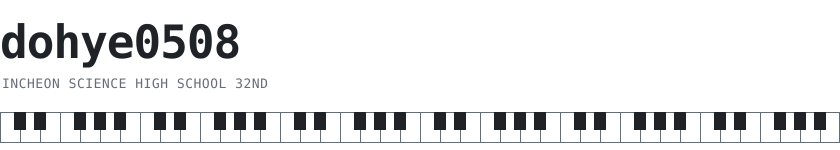

<picture>
  <source media="(prefers-color-scheme: dark)" srcset="assets/header-dark.svg">
  
</picture>

### Awards

| 연도 | 대회 | 수상 |
| :--: | :-- | :-- |
| `2026` | **제8회 한국코드페어** 해커톤 | 본선 금상 |
| `2026` | **제46회 인천광역시과학전람회** | 특상 |
| `2025` | **과학영재 창의연구(R&E) 발표대회** 정보분야 | 본선 진출, 혁신도전상 |
| `2025` | **제11회 빛가람 에너지밸리 소프트웨어 경진대회** | 장려상 |

### Activities

| 연도 | 활동 |
| :--: | :-- |
| `2026` | 인천과학고등학교 정보동아리 **RAIBIT** 짱 |
| `2025` | [**인곽위키**](https://github.com/gyu0ne/ISHS_Wiki) 개발 참여 |

### Stack

### Problem Solving

[solved.ac](https://solved.ac/lacampanella09/) · [BOJ](https://www.acmicpc.net/user/lacampanella09)
